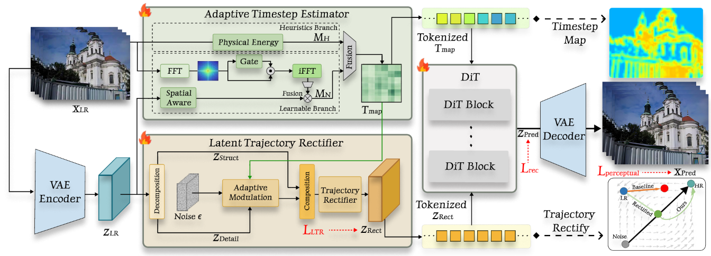

# ART-VSR

**ART-VSR: Adaptive Rectified Trajectories for One-Step Video Super-Resolution**

[Paper (ECCV 2026)](https://media.eventhosts.cc/Conferences/ECCV2026/pdfs/6876.pdf) | [Model Checkpoint](https://drive.google.com/file/d/15Xs_sdUpXnXhg2nvuCmgpElUdD_MO6Di/view?usp=sharing)

ART-VSR performs one-step video super-resolution with an Adaptive Timestep Estimator (ATE) and a Latent Trajectory Rectifier (LTR).



## Installation

Use Python 3.11 and an NVIDIA GPU with a CUDA-compatible PyTorch installation. Inference uses `torch.bfloat16`.

```bash
conda create -n artvsr python=3.11 -y
conda activate artvsr
pip install -r requirements.txt
```

Alternatively, create the environment from the provided configuration:

```bash
conda env create -f environment.yml
conda activate artvsr
```

The dependency versions are listed in `requirements.txt`. If necessary, install the PyTorch build appropriate for your CUDA driver.

## Model Download

Download [artvsr_full.safetensors from Google Drive](https://drive.google.com/file/d/15Xs_sdUpXnXhg2nvuCmgpElUdD_MO6Di/view?usp=sharing) and place it in `weights/`:

```text
weights/
  artvsr_full.safetensors
```

The checkpoint includes the DiT, VAE, ATE, LTR, and fixed prompt embedding. No separate base-model or text-encoder download is required.

## Directory Structure

```text
ART_VSR/
  artvsr/
    ate.py
    ltr.py
    spatial_flow.py
    pipeline.py
    checkpoint.py
    postprocess.py
    wan/
  weights/
    artvsr_full.safetensors
  input_frames/
  img/
    ppl.png
  results/
  inference.py
  run_inference.sh
  requirements.txt
  environment.yml
  README.md
```

Create input and output directories as needed. The model checkpoint, input frames, and generated results are stored separately from the source code.

## Inference

Place the low-resolution frames of one video in a directory. PNG and JPEG files are supported and sorted by frame number:

```text
input_frames/
  00000000.png
  00000001.png
  00000002.png
```

```bash
python inference.py \
  --input_dir input_frames \
  --output_dir results/demo \
  --checkpoint weights/artvsr_full.safetensors \
  --chunk_size 17 \
  --overlap 5
```

Input frames are bicubic-upscaled by 4 before restoration. The output preserves the input frame count and filenames. This entrypoint reads and writes image sequences; decode video files into frames before running it.

The launcher uses the same temporal settings:

```bash
bash run_inference.sh --input_dir input_frames --output_dir results/demo
```

## Citation

If you use ART-VSR in your research, please cite:

```bibtex
@inproceedings{zhang2026artvsr,
  title={ART-VSR: Adaptive Rectified Trajectories for One-Step Video Super-Resolution},
  author={Zhang, Jianhui and Fang, Chen and Wang, Hao and Feng, Chaoyu and Lei, Lei and Wang, Jue and Liu, Shuaicheng},
  booktitle={European Conference on Computer Vision (ECCV)},
  year={2026},
  url={https://media.eventhosts.cc/Conferences/ECCV2026/pdfs/6876.pdf}
}
```

## Acknowledgements

ART-VSR builds on [Wan2.1](https://github.com/Wan-Video/Wan2.1) and [DiffSynth-Studio](https://github.com/modelscope/DiffSynth-Studio).
